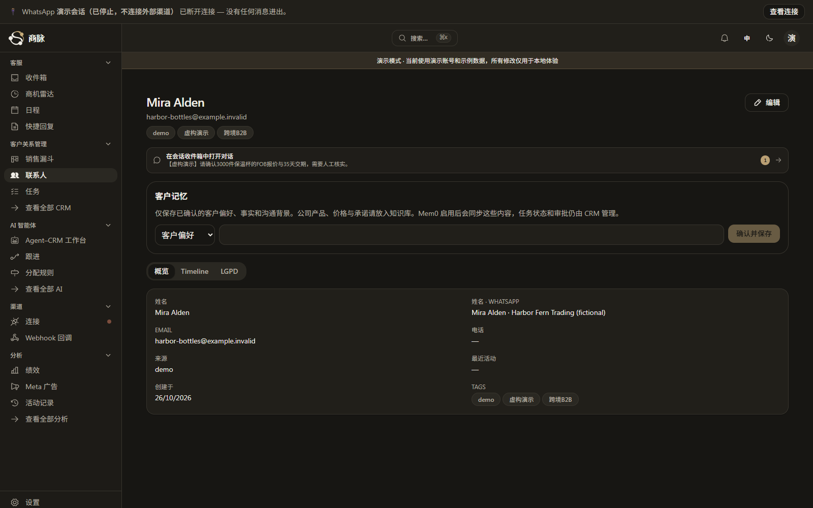
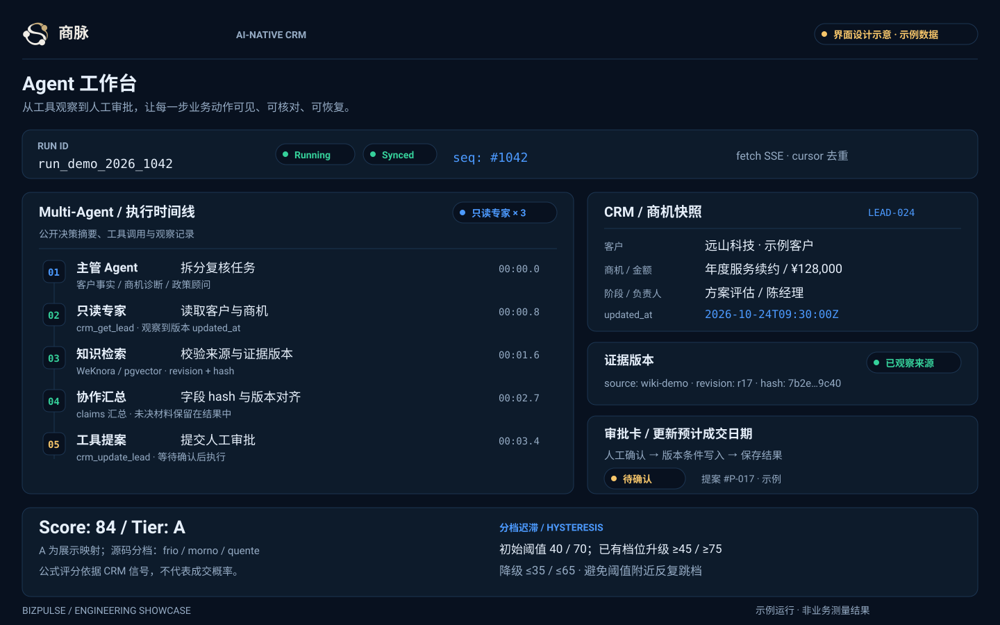
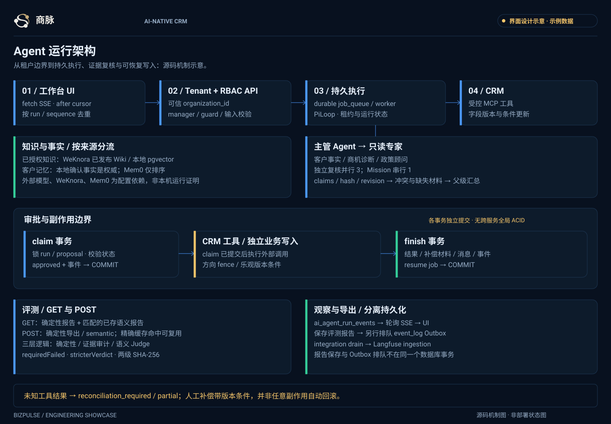
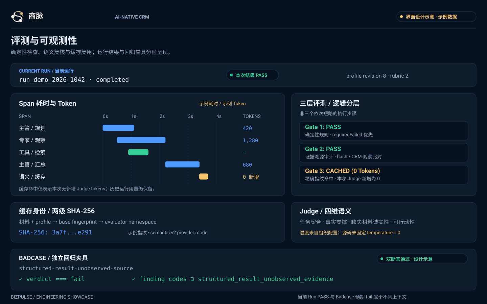

# 商脉 · BizPulse CRM

<p align="center">
  <picture><source media="(prefers-color-scheme: dark)" srcset="apps/crm/docs/brand/shangmai-icon-dark.svg" /></picture>
</p>

<p align="center">
  <strong>面向 B2B 销售的 AI 原生 CRM 工作台</strong><br />
  把客户上下文、销售推进与人工决策放在一条可追溯的工作流里。
</p>

<p align="center">
  <a href="#产品截图">产品截图</a> ·
  <a href="#核心能力">核心能力</a> ·
  <a href="#快速开始">快速开始</a> ·
  <a href="apps/crm/docs/showcase/architecture.md">系统架构</a> ·
  <a href="apps/crm/docs/showcase/ownership.md">来源与改造边界</a>
</p>

> 一句话：从客户与商机出发，在同一工作区查看上下文、运行 Agent 建议，并由人确认关键操作。

## 我们的产品

商脉是一个自托管、多租户 B2B CRM。销售看板、联系人和任务构成业务入口；Agent 工作台将客户上下文、运行记录与人工审批连接起来。

以下两张产品截图来自真实运行的 CRM 页面，使用明确标注的隔离虚构演示数据。三张工程图用于解释设计与机制，图中的数字和记录是示例，不代表实测结果。

## 产品截图

<p align="center">
  
</p>
<p align="center"><em>销售看板——查看阶段、金额与商机详情。</em></p>

<p align="center">
  
</p>
<p align="center"><em>客户上下文——从同一虚构客户进入联系人资料与关联记录。</em></p>

## 核心能力

### 销售与客户上下文

- 在漏斗中跟踪商机、阶段与金额；联系人、商机和任务关联到业务记录。
- 中英文界面覆盖主要验收路线；客户名称与用户输入按原文展示。
- 隔离演示组织提供标注清楚的虚构 B2B 数据。

### Agent 工作台与人工控制

- 查看 Agent 运行与回放、专家协作和待确认的操作。
- 对受支持的业务变更进行人工批准、拒绝与有条件撤销；审批和外部系统写入的事务边界见[架构说明](apps/crm/docs/showcase/architecture.md)。
- 本地确定性交互沙箱不依赖模型或数据库，结果仅用于展示交互。

<p align="center">
  
</p>
<p align="center"><em>工作台机制示意——图中运行记录与数字为示例。</em></p>

### 架构与评测

- 运行时包含流式事件、证据上下文、审批状态及回放；可从[源码证据](apps/crm/docs/showcase/source-evidence.md)追踪实现。
- 评测、材料指纹与缓存机制见[评测口径](apps/crm/docs/showcase/metrics-baseline.md)。给定百分比为待验证目标，不作为实测成绩。

<p align="center">
  
</p>
<p align="center"><em>系统架构与主要边界。</em></p>

<p align="center">
  
</p>
<p align="center"><em>评测流程示意——图中指标与数值为示例。</em></p>

## 快速开始

### 无 Key 的离线交互沙箱

需要 Node.js 22+；无需安装依赖、Docker、数据库或模型密钥：

```sh
git clone https://github.com/wcy12378/BizPulse-CRM.git
cd BizPulse-CRM/apps/crm
node scripts/demo-offline.mjs
```

按终端地址打开，页面与数据均为虚构演示。沙箱不执行真实数据库写入或外发消息。

### 真实 CRM 本地演示

需要 Node.js 22+、pnpm、Docker 与 Compose v2。使用新 clone，脚本会保护已有 `.env.local`：

```sh
cd BizPulse-CRM/apps/crm
pnpm install --frozen-lockfile
node scripts/demo-setup.mjs --pull
pnpm demo --port=54349
```

首次准备会下载镜像并构建；后续可复用。详细步骤、停止方法及数据目录见[快速开始](apps/crm/docs/showcase/quickstart.md)。

## 项目状态

已在本地具名路线中验证真实账号登录、联系人/商机/任务闭环、输入与权限拒绝、并发冲突、中英文主要页面和重启复用。完整记录与限制见[交付审计](apps/crm/docs/showcase/delivery-audit.md)。

真实模型、外发消息、Mem0、WeKnora、Langfuse、Realtime 与正式后台任务需要另行配置和验收；不将离线演示视为外部集成实测。

## 仓库结构

| 路径 | 内容 |
| --- | --- |
| [`apps/crm/`](apps/crm/package.json) | CRM 应用、组件、Agent 运行时与测试 |
| [`apps/crm/docs/showcase/`](apps/crm/docs/showcase/product-tour.md) | 产品导览、架构、验证和归属说明 |
| [`apps/crm/docs/brand/`](apps/crm/docs/brand/README.md) | 商脉品牌标识 |
| [`apps/crm/infra/demo/`](apps/crm/infra/demo/compose.yml) | 隔离本地演示环境 |
| [`apps/crm/supabase/`](apps/crm/supabase/baseline.sql) | 数据库基线与迁移 |

## 文档与许可

- [产品导览](apps/crm/docs/showcase/product-tour.md) · [系统架构](apps/crm/docs/showcase/architecture.md) · [源码证据](apps/crm/docs/showcase/source-evidence.md)
- [快速开始](apps/crm/docs/showcase/quickstart.md) · [评测口径](apps/crm/docs/showcase/metrics-baseline.md) · [交付审计](apps/crm/docs/showcase/delivery-audit.md)
- [来源与改造边界](apps/crm/docs/showcase/ownership.md) · [MIT 许可证](LICENSE)

项目保留原 MIT 版权声明；既有实现与本地改造的边界见归属说明。