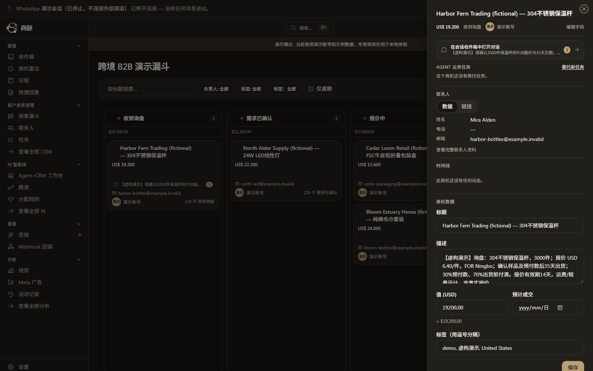

# 商脉 / BizPulse CRM

一个自托管、多租户的 B2B CRM：把客户线索、Agent 任务、人工审批、运行回放与评测证据放进同一条可审计链路。

## 5 个关键画面

业务入口 → Agent → 客户上下文 → 运行时 → 评测：

### 1. B2B 销售看板与线索详情


### 2. Agent 工作台


### 3. 同一客户的 360° 上下文


### 4. 运行时架构


### 5. 评测与材料指纹


完整截图动线见 [产品导览](docs/showcase/product-tour.md)，架构边界见 [架构说明](docs/showcase/architecture.md)。

## 10 秒离线体验

无需 Key、Docker、数据库或 `node_modules`（仅需 Node.js 22+）：

```sh
node scripts/demo-offline.mjs
# 或
pnpm demo:offline
```

这是隔离的、明确标注为虚构数据的交互沙箱，不代表真实数据库写入、模型调用或外部消息发送。

## 真实 CRM 本地演示

需要 Node.js 22+、pnpm、Docker Desktop（Compose v2）。请使用新的 clone；脚本拒绝覆盖已有 `.env.local`。

```sh
pnpm install --frozen-lockfile
node scripts/demo-setup.mjs --pull
pnpm demo --port=54349
```

已配置过的实例可复用：

```sh
node scripts/demo-setup.mjs
pnpm demo --port=54349
```

运行数据默认在 `D:/CRM-local/showcase`（可用 `CRM_RUNTIME_DIR` 覆盖）。这条路线使用独立 Supabase 栈与虚构演示组织，不启动模型、worker、cron 或外部消息集成。详细首次安装、复用、停止和排障见 [quickstart](docs/showcase/quickstart.md)。

## 项目证据

- [源码证据](docs/showcase/source-evidence.md)
- [公开归属与改造边界](docs/showcase/ownership.md)
- [评测口径与当前证据](docs/showcase/metrics-baseline.md)
- [发布审计](docs/showcase/delivery-audit.md)

## 许可

请先阅读仓库中的许可证与归属说明，再用于生产部署或二次分发。
